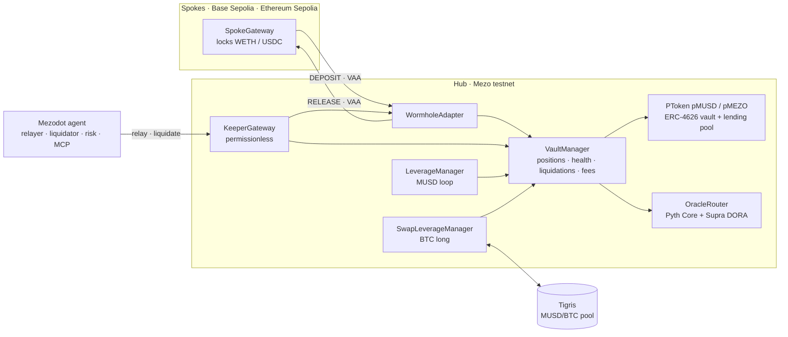

<p align="center">
  
</p>

<h1 align="center">Mezodot Protocol</h1>

<p align="center">
  <strong>An omnichain money market that makes MUSD and MEZO productive, composable capital — native to Mezo.</strong>
</p>

<p align="center">
  
  
  
  
  
  
  
</p>

<p align="center">
  
  
  
  
  
  
  
  
  
  
  
  
  
  
</p>

<p align="center">
  <a href="https://github.com/mdlog/mezodot/actions/workflows/ci.yml"></a>
  
  <a href="#deployments"></a>
  <a href="#security"></a>
  
</p>

<p align="center">
  <a href="#overview">Overview</a> ·
  <a href="#architecture">Architecture</a> ·
  <a href="#deployments">Deployments</a> ·
  <a href="#getting-started">Getting started</a> ·
  <a href="#testing">Testing</a> ·
  <a href="#security">Security</a> ·
  <a href="#roadmap">Roadmap</a>
</p>

> [!WARNING]
> Mezodot runs on **testnets only** (Mezo testnet, Base Sepolia, Ethereum Sepolia) and has **not been audited**. A single owner key controls every contract and can move user funds ([Security](#security)). Do not use it with real value.

## Overview

Mezodot is a lending market whose hub lives on Mezo. Liquidity, positions and liquidations live on the hub, and collateral can stay on its home chain:

- **Supply** MUSD or MEZO and receive **pMUSD / pMEZO**: yield-bearing ERC-4626 shares that keep earning while posted as collateral.
- **Borrow** MUSD or MEZO on the hub against pTokens, against **BTC** held on Mezo, or against **WETH / USDC locked on Base Sepolia or Ethereum Sepolia** (Wormhole-verified cross-chain collateral). One health factor covers every chain.
- **Leverage in one transaction:** go **long BTC** through a Tigris flash swap, or open a **1-click MUSD loop** on the pool's own flash loan and unwind it by netting debt against the posted pMUSD.
- **Permissionless keepers** relay Wormhole messages and liquidate through `KeeperGateway`. The Mezodot agent does both, and contracts verify every VAA and price proof, so nobody has to trust it.
- **Risk for AI agents:** an **MCP server** exposes markets, positions and quantitative risk (volatility, VaR-based LTV advice, walk-forward + Deflated Sharpe).
- **On-chain revenue:** the reserve factor, the flash-loan fee and a share of every liquidation bonus accrue on-chain and are reported per pool and per collateral.

Built for the **Mezo Buildathon, Track 1** (DeFi: borrowing, lending, looping, yield).

### The app

| Page          | Route            | What you can do                                                                                                         |
| ------------- | ---------------- | ----------------------------------------------------------------------------------------------------------------------- |
| Landing       | `#/`             | The product story, with motion drawn from the protocol's own flows                                                      |
| Overview      | `#/dashboard`    | TVL, protocol revenue, markets and recent activity                                                                      |
| Markets       | `#/markets`      | Supply MUSD or MEZO for pMUSD / pMEZO, whose exchange rate grows with borrower interest                                 |
| Cross-chain   | `#/crosschain`   | Lock WETH / USDC on a spoke, follow each Wormhole message through its lifecycle, relay it yourself, withdraw to a spoke |
| Borrow        | `#/borrow`       | Borrow MUSD or MEZO against pTokens, BTC and spoke collateral                                                           |
| Loop          | `#/loop`         | Leverage desk: a BTC long through a Tigris flash swap, or a pMUSD supply loop on the MUSD pool's flash loan (0.09% fee) |
| Agents & risk | `#/agents`       | Keepers, liquidations and the agent's risk report                                                                       |
| Architecture  | `#/architecture` | The capital topology as a system diagram with user journeys                                                             |
| Activity      | `#/activity`     | Your on-chain history across the hub and the spokes, read from contract events                                          |

Wallets: **Mezo Passport** (Unisat, OKX and Xverse through Mezo smart accounts) and EVM wallets through RainbowKit / WalletConnect.

## Architecture



- **`VaultManager`** is the only ledger of positions: collateral, debt in each hub market, borrow limits, health and liquidations.
- **`PToken`** is both an ERC-4626 vault and its market's lending pool: borrow index, kinked interest rates, reserves and ERC-3156 flash loans.
- **`SpokeGateway`** keeps WETH / USDC on its home chain. A deposit sends a `DEPOSIT` message over Wormhole Core, and a withdrawal comes back as a `RELEASE`. Messages are bound to their destination and verified on-chain.
- **`OracleRouter`** reads Pyth Core on Mezo and keyless Supra DORA proofs. The freshest usable leg wins, with a max age per leg, confidence caps and a fail-closed cross-check.
- **`LeverageManager`** loops MUSD on the pool's flash loan. **`SwapLeverageManager`** opens and closes BTC longs through a Tigris flash swap.
- **`KeeperGateway`** lets anyone relay messages and liquidate. The [agent](services/agent/README.md) provides liveness, never safety.

## How MUSD, MEZO and BTC are used

| Integration                                                                                                                                                                                          | Where                                       |
| ---------------------------------------------------------------------------------------------------------------------------------------------------------------------------------------------------- | ------------------------------------------- |
| Real testnet **MUSD** (`0x1189…c503`) and **MEZO** (`0x7B7c…0001`) are the pool assets                                                                                                               | `PToken`, `DeployHub.s.sol`                 |
| pMUSD / pMEZO: yield-bearing ERC-4626 receipts, usable as collateral while earning                                                                                                                   | `PToken`, `VaultManager`                    |
| Borrow MUSD **or** MEZO against pTokens, BTC and cross-chain collateral                                                                                                                              | `VaultManager`                              |
| Mezo's native **BTC** (ERC-20 precompile `0x7b7C…0000`) as plain hub collateral (LTV 70%, liquidation threshold 78%)                                                                                 | `VaultManager`                              |
| **BTC long in one transaction**: a flash swap on Tigris' MUSD/BTC pool buys BTC, posts it, and borrows exactly the MUSD that pays the pool (no flash fee); close sells BTC to repay                  | `SwapLeverageManager`                       |
| 1-click **MUSD loop** via the pool's own ERC-3156 flash loan; the unwind nets debt against the posted pMUSD (`repayWithCollateral`), so it works at any utilisation                                  | `LeverageManager`, `VaultManager`           |
| Mezo's oracle stack: Pyth Core on Mezo (`0x933a…1315`: Mezo's hourly push, 120 s legs for ETH/BTC) and keyless Supra DORA proofs as a second leg for ETH, USDC and BTC; the freshest usable leg wins | `OracleRouter`, `PythSource`, `SupraSource` |
| Mezo's Wormhole Core (chain 50) for cross-chain collateral                                                                                                                                           | `WormholeAdapter`, `SpokeGateway`           |
| **Mezo Passport** wallets (Unisat, OKX, Xverse via Mezo smart accounts) + EVM wallets                                                                                                                | `apps/web/src/chain/wagmi.ts`               |
| BTC is the gas token; oracle fees are paid in BTC                                                                                                                                                    | all risk-checked calls                      |

## User flows

- **A — Passive LP:** supply 10,000 MUSD → pMUSD; the exchange rate rises with borrower interest.
- **B — Cross-chain borrower:** lock WETH in the Base or Ethereum `SpokeGateway` → Wormhole `DEPOSIT` → `VaultManager` credit → borrow MUSD on Mezo. A withdrawal sends a `RELEASE` back.
- **C — Looper:** 1,000 MUSD × 3 → flash 2,000, supply 3,000, borrow 2,001.8 (0.09% fee), repay the flash loan, all in one transaction. The unwind nets the debt against the posted pMUSD: no second fee.
- **BTC long:** 0.01 BTC at 2× → borrow the MUSD worth 0.01 BTC, buy BTC on Tigris inside the swap callback, and post about 0.02 BTC (less the swap fee and price impact); the debt is exactly the borrow. Closing sells just enough BTC to repay and returns the rest.

## Deployments

The hub runs on **Mezo testnet** (chain 31611), with spokes on **Base Sepolia** (84532) and **Ethereum Sepolia** (11155111), linked both ways. The addresses come from [`packages/sdk/src/deployments`](packages/sdk/src/deployments), and `pnpm verify:deployment mezo-testnet` checks them against the chains.

All 14 contracts are **exact matches on Sourcify**, and both spoke gateways are also verified on Blockscout. Mezo's testnet Blockscout cannot verify the via-IR hub builds yet ([DEPLOY.md, step 4](docs/DEPLOY.md#4-verify)), so the hub's sources are linked on Sourcify.

**Hub (Mezo testnet)**

| Contract                 | Address                                                                                                                           | Source                                                                                 |
| ------------------------ | --------------------------------------------------------------------------------------------------------------------------------- | -------------------------------------------------------------------------------------- |
| VaultManager             | [`0x7a2e248Aa4799B3A6ef16a647E4F88A512B854F7`](https://explorer.test.mezo.org/address/0x7a2e248Aa4799B3A6ef16a647E4F88A512B854F7) | [Sourcify](https://repo.sourcify.dev/31611/0x7a2e248Aa4799B3A6ef16a647E4F88A512B854F7) |
| pMUSD (PToken)           | [`0x3E6F3719E919cF0Dc01d3019B8df913C472fDfB0`](https://explorer.test.mezo.org/address/0x3E6F3719E919cF0Dc01d3019B8df913C472fDfB0) | [Sourcify](https://repo.sourcify.dev/31611/0x3E6F3719E919cF0Dc01d3019B8df913C472fDfB0) |
| pMEZO (PToken)           | [`0x91Ba543447b23e199F0223198e61E6Bb812dAcfc`](https://explorer.test.mezo.org/address/0x91Ba543447b23e199F0223198e61E6Bb812dAcfc) | [Sourcify](https://repo.sourcify.dev/31611/0x91Ba543447b23e199F0223198e61E6Bb812dAcfc) |
| OracleRouter             | [`0x5d676a3F6477651C7BdE6442D0FD08aDf0b2eaeD`](https://explorer.test.mezo.org/address/0x5d676a3F6477651C7BdE6442D0FD08aDf0b2eaeD) | [Sourcify](https://repo.sourcify.dev/31611/0x5d676a3F6477651C7BdE6442D0FD08aDf0b2eaeD) |
| PythSource               | [`0x2418E20877E72add21E383a8dD434938FDcCEbe4`](https://explorer.test.mezo.org/address/0x2418E20877E72add21E383a8dD434938FDcCEbe4) | [Sourcify](https://repo.sourcify.dev/31611/0x2418E20877E72add21E383a8dD434938FDcCEbe4) |
| SupraSource              | [`0x5C65CBE1Fb6F81EDcC5cF3dfB9aC6866428719fb`](https://explorer.test.mezo.org/address/0x5C65CBE1Fb6F81EDcC5cF3dfB9aC6866428719fb) | [Sourcify](https://repo.sourcify.dev/31611/0x5C65CBE1Fb6F81EDcC5cF3dfB9aC6866428719fb) |
| InterestRateModel (MUSD) | [`0x2083d3dCacE0B413Ff34C1Fa14d1f624431168Eb`](https://explorer.test.mezo.org/address/0x2083d3dCacE0B413Ff34C1Fa14d1f624431168Eb) | [Sourcify](https://repo.sourcify.dev/31611/0x2083d3dCacE0B413Ff34C1Fa14d1f624431168Eb) |
| InterestRateModel (MEZO) | [`0xa0ed4562514168C6AAaaB06E9cB368e80f79E046`](https://explorer.test.mezo.org/address/0xa0ed4562514168C6AAaaB06E9cB368e80f79E046) | [Sourcify](https://repo.sourcify.dev/31611/0xa0ed4562514168C6AAaaB06E9cB368e80f79E046) |
| WormholeAdapter          | [`0x8be48D8A0a308F78381aB6Ff7D51e1390BFa2880`](https://explorer.test.mezo.org/address/0x8be48D8A0a308F78381aB6Ff7D51e1390BFa2880) | [Sourcify](https://repo.sourcify.dev/31611/0x8be48D8A0a308F78381aB6Ff7D51e1390BFa2880) |
| LeverageManager          | [`0x32295B6C7EBd6434D7C930FFf4b5845fccA4d32d`](https://explorer.test.mezo.org/address/0x32295B6C7EBd6434D7C930FFf4b5845fccA4d32d) | [Sourcify](https://repo.sourcify.dev/31611/0x32295B6C7EBd6434D7C930FFf4b5845fccA4d32d) |
| SwapLeverageManager      | [`0xa0fC085Ed22407972e7086864cAC35C662Ba73CC`](https://explorer.test.mezo.org/address/0xa0fC085Ed22407972e7086864cAC35C662Ba73CC) | [Sourcify](https://repo.sourcify.dev/31611/0xa0fC085Ed22407972e7086864cAC35C662Ba73CC) |
| KeeperGateway            | [`0x2e63B1Af8E56E5a7Af02Da36E0B0313f91dedc11`](https://explorer.test.mezo.org/address/0x2e63B1Af8E56E5a7Af02Da36E0B0313f91dedc11) | [Sourcify](https://repo.sourcify.dev/31611/0x2e63B1Af8E56E5a7Af02Da36E0B0313f91dedc11) |

**Spokes**

| Chain            | SpokeGateway                                                                                                                           | Source                                                                                    |
| ---------------- | -------------------------------------------------------------------------------------------------------------------------------------- | ----------------------------------------------------------------------------------------- |
| Base Sepolia     | [`0x587BA0A40aCC1d1DE86654b59118220097C0207D`](https://base-sepolia.blockscout.com/address/0x587BA0A40aCC1d1DE86654b59118220097C0207D) | [Sourcify](https://repo.sourcify.dev/84532/0x587BA0A40aCC1d1DE86654b59118220097C0207D)    |
| Ethereum Sepolia | [`0x75E52c9471DC55C2a24b946bC6baDe125AfB7170`](https://eth-sepolia.blockscout.com/address/0x75E52c9471DC55C2a24b946bC6baDe125AfB7170)  | [Sourcify](https://repo.sourcify.dev/11155111/0x75E52c9471DC55C2a24b946bC6baDe125AfB7170) |

**External contracts on Mezo testnet**

| Contract             | Address                                      |
| -------------------- | -------------------------------------------- |
| MUSD                 | `0x118917a40FAF1CD7a13dB0Ef56C86De7973Ac503` |
| MEZO (precompile)    | `0x7B7c000000000000000000000000000000000001` |
| BTC (precompile)     | `0x7b7C000000000000000000000000000000000000` |
| Pyth Core            | `0x933aDeC2C7624b11E4B2b80ACE15BF9a71a31315` |
| Supra pull oracle    | `0x443A0f4Da5d2fdC47de3eeD45Af41d399F0E5702` |
| Wormhole Core        | `0x268557122Ffd64c85750d630b716471118F323c8` |
| Tigris MUSD/BTC pool | `0xd16A5Df82120ED8D626a1a15232bFcE2366d6AA9` |
| Tigris router        | `0x9a1ff7FE3a0F69959A3fBa1F1e5ee18e1A9CD7E9` |

**Risk parameters**

| Collateral | Chain                           | LTV | Liquidation threshold | Liquidation bonus |
| ---------- | ------------------------------- | --- | --------------------- | ----------------- |
| pMUSD      | Mezo                            | 80% | 85%                   | 5%                |
| pMEZO      | Mezo                            | 50% | 60%                   | 10%               |
| BTC        | Mezo                            | 70% | 78%                   | 5%                |
| WETH       | Base Sepolia · Ethereum Sepolia | 75% | 80%                   | 7%                |
| USDC       | Base Sepolia · Ethereum Sepolia | 80% | 85%                   | 5%                |

Both pools keep a 10% reserve factor, flash loans cost 0.09%, and the treasury takes 10% of each liquidation bonus ([REVENUE.md](docs/REVENUE.md)).

## Getting started

### Prerequisites

- Node.js 22 and pnpm 11
- Foundry ≥ 1.5 and jq
- Docker (optional, for the agent image)

### Install

```bash
git clone https://github.com/mdlog/mezodot.git
cd mezodot
pnpm install
git submodule update --init --recursive        # contracts/lib
```

### Run on a local two-chain devnet (no testnet funds)

```bash
pnpm devnet                                     # anvil hub :8545 + spoke :8546, deploy + configure + seed

# terminal 2 — agent (anvil #1 as keeper, dev guardian signs VAAs locally)
cd services/agent && MEZODOT_ENV=devnet \
  KEEPER_PRIVATE_KEY=0x59c6995e998f97a5a0044966f0945389dc9e86dae88c7a8412f4603b6b78690d \
  DEVNET_GUARDIAN_KEY=0x2a871d0798f97d79848a013d4936a73bf4cc922c825d33c1cf7073dff6d409c6 \
  pnpm start

# terminal 3 — web app on the devnet
VITE_MEZODOT_ENV=devnet pnpm dev               # http://localhost:3000 (landing page; the app is at #/dashboard)
```

Import an anvil account (e.g. #2 `0x5de4111afa1a4b94908f83103eb1f1706367c2e68ca870fc3fb9a804cdab365a`) into MetaMask with the networks `http://127.0.0.1:8545` (chain 31337) and `http://127.0.0.1:8546` (chain 31338). The keys above are Foundry's public test keys: never use them anywhere else.

### Run against the testnet deployment

```bash
cp services/agent/.env.example services/agent/.env   # MEZODOT_ENV=testnet; without KEEPER_PRIVATE_KEY the agent runs read-only
pnpm --filter @mezodot/agent start                     # http://127.0.0.1:8787/health

pnpm dev                                               # web app on testnet (the default), using the local agent
```

The web app needs the agent's `/oracle/update` relay for Supra price proofs, and reads its stats and risk report. A production build refuses to bundle localhost services: set `VITE_AGENT_URL` and `VITE_WALLETCONNECT_PROJECT_ID` ([`apps/web/.env.example`](apps/web/.env.example), [DEPLOY.md, steps 6–7](docs/DEPLOY.md#6-agent)). Agent configuration: [`services/agent/README.md`](services/agent/README.md).

### Repository layout

```
contracts/          Foundry: hub (Mezo) and spoke contracts, unit/fuzz/invariant/E2E tests, deploy scripts
packages/sdk/       ABIs, deployments, contract-mirroring math, Pyth/Wormhole/payload codecs, on-chain reader
services/agent/     relayer · liquidator · risk engine · MCP server (stdio + HTTP) · Docker
apps/web/           React + wagmi + Mezo Passport dApp
scripts/            ops: deployment check, revenue report, BTC smoke test, ABI and admin-docs checks
scripts/devnet/     two-chain local devnet (anvil hub + spoke) using the production deploy scripts
docs/               DEPLOY, RUNBOOK, REVENUE and SECURITY docs; the original design spec and plan
.github/workflows/  CI on every pull request; nightly testnet, fork and devnet checks
```

## Testing

| Suite                                  | Command                                                                                         | What it proves                                                                                                                                                                                                                                                                                                                                                                                                                                                                                                                                                         |
| -------------------------------------- | ----------------------------------------------------------------------------------------------- | ---------------------------------------------------------------------------------------------------------------------------------------------------------------------------------------------------------------------------------------------------------------------------------------------------------------------------------------------------------------------------------------------------------------------------------------------------------------------------------------------------------------------------------------------------------------------- |
| Contracts (210 tests)                  | `pnpm test:contracts`                                                                           | Rate model, ERC-4626 + flash-loan accounting (incl. share-price manipulation), multi-source oracle (freshest leg, per-leg max age, confidence caps, fail-closed cross-check), borrow limits, liquidation, protocol fee and bad-debt write-off, repay with collateral, Wormhole replay/emitter/destination checks and message fees, MUSD loop/unwind, BTC leverage through a Tigris flash swap, **invariants** (pool solvency, hub credit ≤ spoke locked, whole-hub accounting), PRD flows A/B/C across two spokes. `DevWormhole` verifies a **real Mezo-testnet VAA**. |
| Mezo fork (5 tests)                    | `MEZO_FORK_RPC=https://rpc.test.mezo.org forge test --root contracts --match-contract ForkMezo` | Hub flows against **live Mezo oracle state**: Pyth push feeds, a real Supra proof unlocking ETH, loop/unwind, borrow and liquidation.                                                                                                                                                                                                                                                                                                                                                                                                                                  |
| SDK, agent, web (79 / 191 / 184 tests) | `pnpm -r check`                                                                                 | Typecheck, lint, unit tests; TS encoders match Solidity bytes; DSR/walk-forward reference values; MCP tools over the MCP protocol.                                                                                                                                                                                                                                                                                                                                                                                                                                     |
| Ops scripts (50 tests)                 | `pnpm check:scripts`, `pnpm check:abis`, `pnpm check:admin-docs`                                | The deployment check and revenue report against fake chains, RPC fallback lists, the BTC smoke test's RPC choice; SDK ABIs equal to the forge build; every `onlyOwner` function listed in SECURITY.md.                                                                                                                                                                                                                                                                                                                                                                 |
| Deployment check                       | `pnpm verify:deployment mezo-testnet`                                                           | The live hub and spokes match their deployment JSON, the SDK ABIs and the documented configuration: code, owners, wiring, 7 collaterals with their risk parameters, reserve factors, feeds, Tigris pool, emitters both ways, spoke backing (DEPLOY.md, step 4).                                                                                                                                                                                                                                                                                                        |
| BTC smoke test                         | `pnpm smoke:btc --keystore <file> --password-file <file>`                                       | On testnet, with tiny amounts: BTC collateral through the real precompile, a BTC position opened, half closed and closed on the real Tigris pool, every wallet movement checked (DEPLOY.md, step 8).                                                                                                                                                                                                                                                                                                                                                                   |
| Autonomous keeper E2E                  | `pnpm devnet:e2e`                                                                               | Spoke deposit → agent relays → borrow (with pull price updates from the agent relay) → ETH drops → **agent liquidates** with a fresh proof → agent relays RELEASE → keeper paid on the spoke.                                                                                                                                                                                                                                                                                                                                                                          |
| Browser E2E                            | `pnpm e2e:ui`                                                                                   | Real UI + wallet: supply 10,000 MUSD, post collateral, lock WETH on the spoke, borrow, 3× loop, activity.                                                                                                                                                                                                                                                                                                                                                                                                                                                              |

`pnpm check` runs the contract, package and ops-script suites. CI ([`ci.yml`](.github/workflows/ci.yml)) runs `forge fmt --check`, `forge build`, `forge test`, the SDK ABI drift check, `prettier --check`, `pnpm -r check`, the ops-script tests and the admin-docs check on every pull request. [`nightly.yml`](.github/workflows/nightly.yml) checks the testnet deployment, runs the Mezo fork tests and deploys a devnet for the keeper E2E.

## Agent and MCP server

The [Mezodot agent](services/agent/README.md) runs one module per job: `relayer` (Wormhole messages both ways), `liquidator` (liquidates HF < 1 through `KeeperGateway` and turns seized collateral back into repay inventory), `oracle` (watchdog and keyed Pyth pusher), `risk` (volatility, VaR, LTV advice, walk-forward + Deflated Sharpe) and `http`.

- **HTTP API:** `/health`, `/metrics` (Prometheus), `/oracle/update` (signed Supra proofs for the web app), `/stats`, `/revenue`, `/risk`, `/liquidatable`, `/messages`, `/events`.
- **MCP tools:** `get_markets`, `get_position`, `get_oracle_health`, `get_risk_report`, `get_revenue`, `simulate_loop`, `simulate_btc_leverage`, `simulate_btc_close`, `simulate_borrow`, `list_liquidatable`, `list_pending_messages`, plus `trigger_liquidation` and `relay_message`, which dry-run unless writes are explicitly enabled.

```bash
claude mcp add mezodot --env MEZODOT_ENV=testnet -- node /path/to/mezodot/services/agent/bin/mcp-stdio.mjs
```

KPIs come from the chain and the agent:

- **TVL:** idle pool cash + BTC collateral on the hub + spoke collateral, net of borrows.
- **Leverage volume:** `LeverageManager.Looped` + `SwapLeverageManager.Opened`.
- **Agent participation:** `KeeperGateway.keeperCount`.
- **Cross-chain borrow ratio:** debt attributed to spoke collateral (agent `/stats`).
- **Protocol revenue:** agent `/revenue`, or `pnpm revenue:report`.

## Security

- **Status:** testnet only, not audited. One EOA owns every contract on all three chains and is the treasury; its powers, including moving user funds, are listed in [SECURITY.md](docs/SECURITY.md#admin-powers-testnet-the-deployer-eoa).
- **Trust assumptions:** Wormhole guardians attest cross-chain messages, Pyth and Supra sign prices, and Tigris executes BTC leverage swaps. Relayers, keepers and the agent are trusted for liveness only ([trust assumptions](docs/SECURITY.md#trust-assumptions)).
- **Tested invariants:** pool solvency, hub credit ≤ spoke locked, and whole-hub accounting, checked by fuzz and invariant suites ([key invariants](docs/SECURITY.md#key-invariants-tested)).
- **Known limitations:** MUSD and MEZO have a single price source (Mezo's hourly Pyth push), so borrows and liquidations touching them revert while it is stale. Relayer liveness, BTC as the gas balance and DEX-vs-oracle prices are covered in [known limitations](docs/SECURITY.md#known-limitations).

## Documentation

| Document                                   | Covers                                                                         |
| ------------------------------------------ | ------------------------------------------------------------------------------ |
| [DEPLOY.md](docs/DEPLOY.md)                | Deploy, verify, smoke test, redeploy, ownership transfer                       |
| [RUNBOOK.md](docs/RUNBOOK.md)              | Incidents: oracle, bridge, keeper, bad debt, pause, key compromise, RPC outage |
| [REVENUE.md](docs/REVENUE.md)              | How protocol revenue accrues, is reported and is collected                     |
| [SECURITY.md](docs/SECURITY.md)            | Security model, admin powers, oracle design, invariants and known limitations  |
| [services/agent](services/agent/README.md) | Agent modules, configuration, HTTP API, MCP, keeper transactions               |
| [docs/superpowers](docs/superpowers)       | The original design spec and implementation plan (historical)                  |

## Roadmap

- [ ] Host the agent (HTTPS) and the web app; record the 2-minute demo
- [ ] MUSD / MEZO price liveness: a Pyth key entitled to MUSD and MEZO, or coverage agreed with Mezo
- [ ] Close the residual price pick window on USDC's Pyth leg and the MUSD and MEZO legs ([SECURITY.md](docs/SECURITY.md#price-pick-window))
- [ ] Fix the nightly devnet keeper E2E: since 2026-10-20 the liquidator skips the test position as unprofitable
- [ ] Hub sources on Mezo's Blockscout, once its verifier handles via-IR builds
- [ ] External audit; timelock + multisig ownership, with a guardian role that can only tighten parameters
- [ ] pToken integrations with Mezo DEX pools (pMUSD/MUSD liquidity)

The full list, with operational items, is in [docs/TODO.md](docs/TODO.md).

## Design notes

**Spokes on Base Sepolia and Ethereum Sepolia** (event-supported chains) instead of Arbitrum, as first planned. Mezo testnet has Wormhole Core but no automatic relayer or NTT, so messages are delivered by the permissionless Mezodot relayer, or by the user from the UI ("Relay it yourself"). Contracts verify every VAA, so relayers need no trust.

**Oracle.** Since the Pyth Core cutover (2026-08-26) Hermes needs a paid API key, so the keyless pull model of the original design no longer works. Mezodot reads the Pyth Core contract that Mezo's own pusher refreshes hourly (MUSD, MEZO, USDC). ETH and BTC have 120 s legs. The agent's keyed pusher refreshes their Pyth prices about every minute with a server-side key, and keyless **Supra DORA** proofs cover the rest: the agent's `/oracle/update` relay fetches them server-side and the transaction verifies them on-chain. Supra is also USDC's second leg. The browser never calls Hermes and no API key is shipped to it ([oracle design](docs/SECURITY.md#oracle-design)).

## Acknowledgements

Built on [Mezo](https://mezo.org) (MUSD, MEZO, BTC, Mezo Passport and its Pyth push), with [Pyth](https://pyth.network) and [Supra](https://supra.com) price feeds, [Wormhole](https://wormhole.com) messaging, Tigris liquidity, [OpenZeppelin Contracts](https://github.com/OpenZeppelin/openzeppelin-contracts) and [Foundry](https://github.com/foundry-rs/foundry).

## License

There is no repository-wide license file yet. The Solidity sources carry SPDX identifiers: MIT, except the vendored `contracts/src/interfaces/IWormhole.sol` (Apache-2.0).
